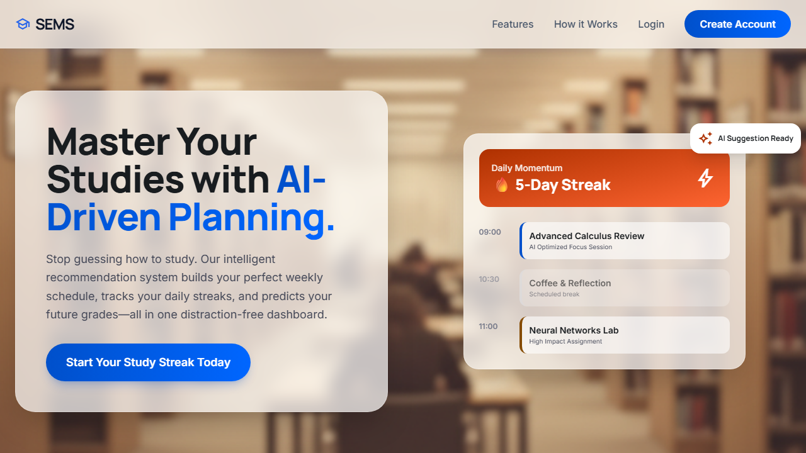

# SMART EDUCATION MANAGEMENT SYSTEM (SEMS)

> An AI-powered student success platform combining Llama 3.3 70B timetable intelligence, adaptive progress tracking, and academic workload analytics.

---

## Overview

University students frequently face academic burnout due to disorganized study routines, unrealistic scheduling, and poor visibility into course syllabus progression. Fixed schedules fail as soon as an unexpected deadline arises, leading to compound study deficits.

**SEMS** is an intelligent academic management system that builds dynamic, personalized study schedules. By evaluating subject difficulty, impending deadlines, and historical task completion rates, SEMS constructs balanced study blocks. If a cloud AI rate limit or outage occurs, the system automatically falls back to an internal deterministic scheduler to guarantee uninterrupted productivity.

---

## Preview



---

## Tech Stack

### Backend & API
- **FastAPI** — Asynchronous web framework for high-throughput academic APIs
- **Python 3.10+** — Core application runtime
- **Pydantic** — Request validation, payload typing, and response serialization
- **SQLAlchemy** — Relational database modeling and query abstraction
- **Alembic** — Database schema migration tracking
- **Uvicorn** — Lightning-fast ASGI application server

### AI & Scheduling
- **Llama 3.3 70B** — Large language model for contextual study timetable generation
- **Groq API** — Ultra-low latency inference engine serving the LLM
- **Rule-Based Fallback Engine** — Algorithmic study allocation ensuring offline reliability

### Database & Storage
- **SQLite** — Local relational database persistence
- **Local Storage** — File storage for avatars and study resources

### Frontend
- **HTML5 & CSS3** — Semantic layout structure
- **Tailwind CSS** — Modern, responsive utility-first interface design
- **Vanilla JavaScript** — Reactive DOM manipulation and asynchronous API communications

---

## Architecture

```text
Student User
     ↓
Frontend Client (Tailwind UI + Asynchronous JS Client)
     ↓
FastAPI Router Layer (Auth, Subjects, Tasks, Milestones, Schedule, Analytics)
     ↓
Business Logic Service Layer (ScheduleService, AIService, LLMService)
     ↓
           Study Scheduler Resolver
          /                        \
    [Groq API / Llama 3.3]     [Rule-Based Fallback Engine]
          \                        /
           Calibrated Weekly Study Blocks
                        ↓
             SQLAlchemy ORM Layer
                        ↓
                SQLite Database
```

1. **Client Interaction**: Students manage subjects, priorities, and deadlines through the dashboard.
2. **Scheduling Request**: The frontend calls the scheduling service with student constraints and task lists.
3. **AI Generation & Fallback**: The platform queries Llama 3.3 via Groq. If unavailable or rate-limited, the internal algorithmic scheduler produces optimized study allocations.
4. **Data Persistence**: Schedules, subject progress, and daily study streaks are committed via SQLAlchemy to SQLite.

---

## Key Features

- **AI-Powered Schedule Generation**: Automatically structures balanced study blocks aligned with syllabus volume and deadlines.
- **Dynamic Recalibration**: Recovers from missed study sessions by shifting pending allocations without manual reschedule.
- **Syllabus & Milestone Tracking**: Visual progress bars and milestones for tracking subject completion percentages.
- **Academic Analytics**: Daily study streaks, time investment breakdowns, and workload heatmaps.
- **Session Authentication**: Secure cookie-based authentication with bcrypt password hashing and CSRF protections.
- **Resource Repository**: Links study materials and course notes directly to relevant curriculum topics.

---

## Getting Started

### 1. Clone the repository

```bash
git clone https://github.com/anshika7427-droid/SEMS-Project.git
cd SEMS-Project
```

### 2. Set up the Python Environment

```bash
# Create and activate virtual environment
python -m venv venv

# Windows (PowerShell):
.\venv\Scripts\Activate.ps1

# macOS / Linux:
source venv/bin/activate

# Install dependencies
pip install -r requirements.txt
```

### 3. Configure Environment Variables

Create a `.env` file in the root directory:

```bash
# Windows
copy .env.example .env

# macOS / Linux
cp .env.example .env
```

Open `.env` and configure your settings:

```env
SECRET_KEY=your-secure-random-secret-key
LLM_API_KEY=gsk_your_groq_api_key
LLM_MODEL=llama-3.3-70b-versatile
LLM_API_URL=https://api.groq.com/openai/v1
```

> **Note**: Never commit your real `.env` file or API keys to version control.

### 4. Run the Application

Start the server using either method:

#### Option A: Quick Launcher

```bash
python run.py
```

This launches Uvicorn and opens the web application in your default browser.

#### Option B: Direct Uvicorn Command

```bash
uvicorn app.main:app --reload --port 8000
```

Visit `http://localhost:8000` to use the application, and `http://localhost:8000/docs` to inspect the Swagger API documentation.

### 5. Running Tests

Execute the automated test suite with pytest:

```bash
pytest
```

---

## Project Structure

```text
SEMS-Project/
├── app/
│   ├── routes/                # Modular API routers (auth, subject, schedule, etc.)
│   ├── services/              # Core business services (ai, llm, schedule, task)
│   ├── utils/                 # Validators, helpers, and security functions
│   ├── ai_engine.py           # Workload analysis & prioritization logic
│   ├── analytics.py           # Study session logs and streak tracking
│   ├── config.py              # Environment configuration loader
│   ├── database.py            # SQLite engine setup & connection pooling
│   ├── main.py                # FastAPI application entry & static mounts
│   ├── models.py              # SQLAlchemy database models
│   ├── scheduler.py           # Deterministic study scheduler fallback
│   └── schemas.py             # Pydantic input/output schemas
├── frontend/                  # Responsive web interface
│   ├── assets/                # Client icons, images, and styling
│   └── pages/                 # HTML templates (dashboard, subjects, etc.)
├── screenshots/               # Real project preview screenshots
│   └── dashboard.png
├── tests/                     # Unit and integration test suite
├── requirements.txt           # Python dependency requirements
├── run.py                     # Convenience launcher script
└── README.md
```

---

## Engineering Highlights

- **Dual-Engine Scheduling Architecture**: Prevents failure modes common in AI wrappers by pairing an LLM prompt pipeline (`llm_service.py`) with a local constraint-satisfaction scheduler (`scheduler.py`). If the Groq API call fails or times out, the user receives an algorithmically valid schedule immediately.
- **Fail-Safe Startup Verification**: The application verifies critical environment keys (such as `SECRET_KEY`) at launch and refuses to boot with insecure defaults.
- **Clean Service-Oriented Separation**: Keeps FastAPI route handlers lightweight by isolating business logic into dedicated services (`app/services/`), simplifying unit testing and mocking.

---

## Demo

Live demo coming soon.
